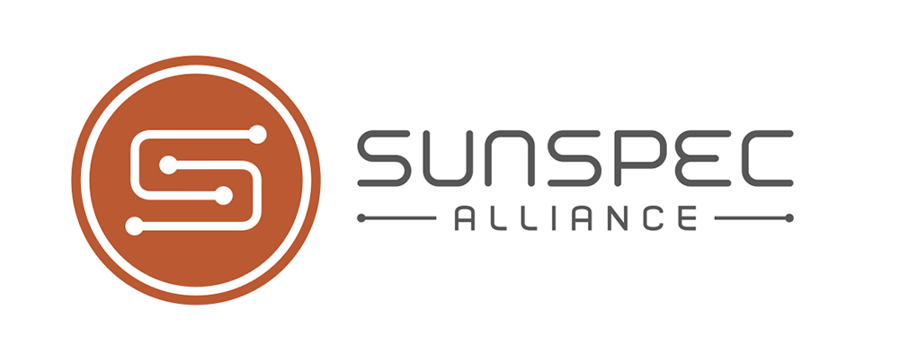

<p align="left">
  
</p>

[![GitHub Release][releases-shield]][releases]
[![GitHub Activity][commits-shield]][commits]
[![License][license-shield]](LICENSE)

[![pre-commit][pre-commit-shield]][pre-commit]
[![Ruff][ruff-shield]][ruff]

[![Marketplace][marketplacebadge]][marketplace]
[![Project Maintenance][maintenance-shield]][user_profile]
[![Project Maintenance][maintenance-shield-enoch85]][user_profile_enoch85]
[![BuyMeCoffee][buymecoffeebadge]][buymecoffee]

[![Discord][discord-shield]][discord]
[![Community Forum][forum-shield]][forum]

## How it works

This custom integration for [Home Assistant](https://home-assistant.io/) monitors any device that speaks SunSpec over Modbus, most commonly a solar inverter or an energy meter. The [SunSpec website](https://sunspec.org/product-certification-registry/) lists certified devices and manufacturers.

It wraps [pysunspec2](https://github.com/sunspec/pysunspec2), the SunSpec Alliance's Python library:

- pysunspec2 talks Modbus TCP, or Modbus RTU over a serial port, to the device, finds the SunSpec models the device has, and decodes their registers with the SunSpec model definitions it ships with: point names, units, scale factors, and the names of states and flags.
- The integration adds the Home Assistant side: setup and options in the UI, reading each selected model at its interval, a device per model, and a sensor for each measurement, state and flag the device reports, with Home Assistant units, device classes and state classes. Its energy sensors work with the energy dashboard out of the box.

Setup finds the device's models and selects the most common ones; Configure chooses exactly which models to read, and how often.

| Platform | Description                                 |
| -------- | ------------------------------------------- |
| `sensor` | A sensor for each value the device reports. |

It reads any device that implements the SunSpec models, whatever the brand, with the definitions that come with pysunspec2. New and corrected models come with new pysunspec2 versions; each release of this integration uses the pysunspec2 version pinned in its `manifest.json`.

## Marketplace Installation

[](https://my.home-assistant.io/redirect/marketplace_repository/?owner=CJNE&repository=ha-sunspec&category=integration)

1. In Settings -> Marketplace, search for "SunSpec" and open it, or use the button above
2. Select "Install"
3. The SunSpec setup opens when the installation is done. If you close it, go to Settings -> Devices & services, click "Add integration" and search for "SunSpec"

## Manual Installation

1. Using the tool of choice open the directory (folder) for your HA configuration (where you find `configuration.yaml`).
2. If you do not have a `custom_components` directory (folder) there, you need to create it.
3. In the `custom_components` directory (folder) create a new folder called `sunspec`.
4. Download _all_ the files from the `custom_components/sunspec/` directory (folder) in this repository.
5. Place the files you downloaded in the new directory (folder) you created.
6. Restart Home Assistant
7. In Settings -> Devices & services, click "Add integration" and search for "SunSpec"

Using your HA configuration directory (folder) as a starting point you should now also have this:

```text
custom_components/sunspec/translations/en.json
custom_components/sunspec/__init__.py
custom_components/sunspec/api.py
custom_components/sunspec/config_flow.py
custom_components/sunspec/const.py
custom_components/sunspec/entity.py
custom_components/sunspec/manifest.json
custom_components/sunspec/recorder.py
custom_components/sunspec/sensor.py
```

## Configuration is done in the UI

<!---->

## Contributions are welcome!

If you want to contribute to this please read the [Contribution guidelines](CONTRIBUTING.md)

## Credits

This project was generated from [@oncleben31](https://github.com/oncleben31)'s [Home Assistant Custom Component Cookiecutter](https://github.com/oncleben31/cookiecutter-homeassistant-custom-component) template.

Code template was mainly taken from [@Ludeeus](https://github.com/ludeeus)'s [integration_blueprint][integration_blueprint] template

## License

MIT, see [LICENSE](LICENSE). The files in `custom_components/sunspec/models/` are SunSpec's 2015 definitions of models 801 to 803, under the Apache License 2.0 in that folder's [LICENSE](custom_components/sunspec/models/LICENSE).

---

[integration_blueprint]: https://github.com/custom-components/integration_blueprint
[buymecoffee]: https://www.buymeacoffee.com/cjne.coffee
[buymecoffeebadge]: https://img.shields.io/badge/buy%20me%20a%20coffee-donate-yellow.svg?style=for-the-badge
[commits-shield]: https://img.shields.io/github/commit-activity/y/cjne/ha-sunspec.svg?style=for-the-badge
[commits]: https://github.com/cjne/ha-sunspec/commits/main
[discord]: https://discord.gg/Qa5fW2R
[discord-shield]: https://img.shields.io/discord/330944238910963714.svg?style=for-the-badge
[marketplace]: https://www.home-assistant.io/integrations/marketplace/
[marketplacebadge]: https://img.shields.io/badge/Marketplace-catalog-41BDF5.svg?style=for-the-badge
[forum-shield]: https://img.shields.io/badge/community-forum-brightgreen.svg?style=for-the-badge
[forum]: https://community.home-assistant.io/
[license-shield]: https://img.shields.io/github/license/cjne/ha-sunspec.svg?style=for-the-badge
[maintenance-shield]: https://img.shields.io/badge/maintainer-%40cjne-blue.svg?style=for-the-badge
[maintenance-shield-enoch85]: https://img.shields.io/badge/maintainer-%40enoch85-blue.svg?style=for-the-badge
[pre-commit]: https://github.com/pre-commit/pre-commit
[pre-commit-shield]: https://img.shields.io/badge/pre--commit-enabled-brightgreen?style=for-the-badge
[releases-shield]: https://img.shields.io/github/release/cjne/ha-sunspec.svg?style=for-the-badge
[releases]: https://github.com/cjne/ha-sunspec/releases
[ruff]: https://github.com/astral-sh/ruff
[ruff-shield]: https://img.shields.io/badge/code%20style-ruff-261230.svg?style=for-the-badge
[user_profile]: https://github.com/cjne
[user_profile_enoch85]: https://github.com/enoch85
